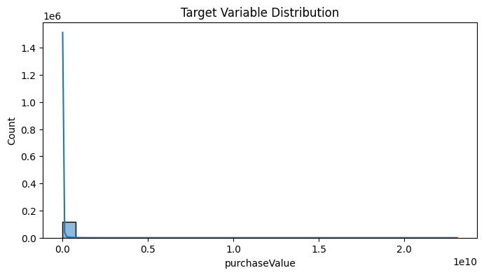
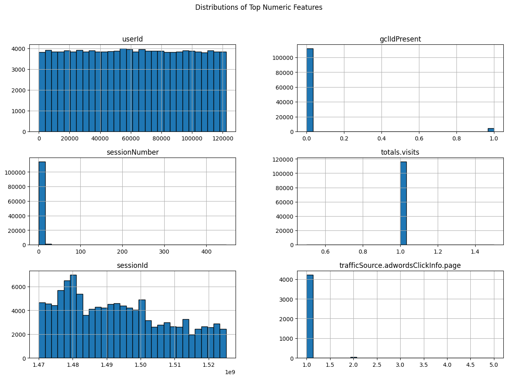
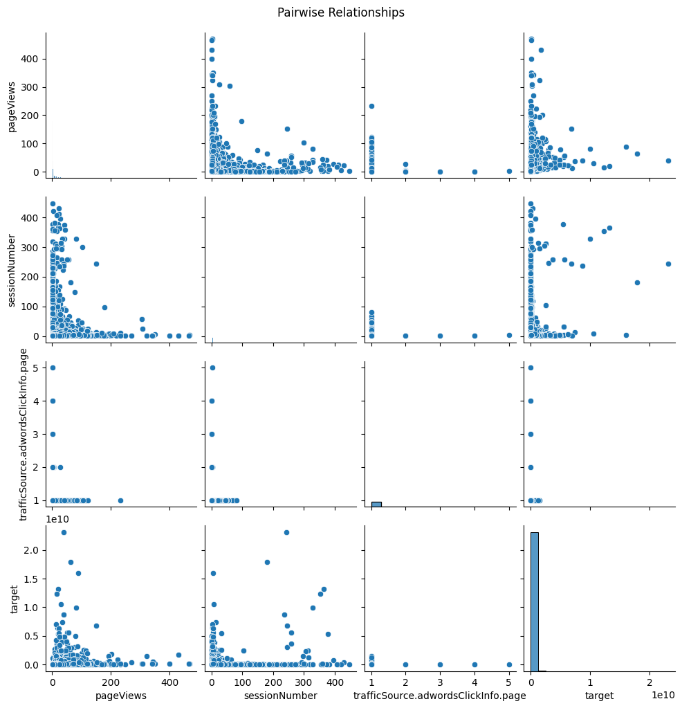
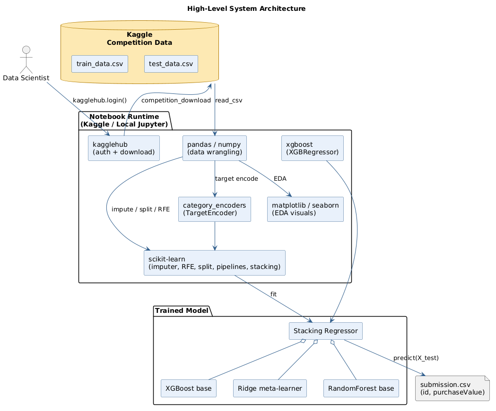
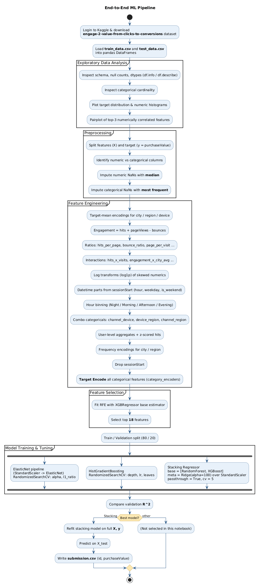
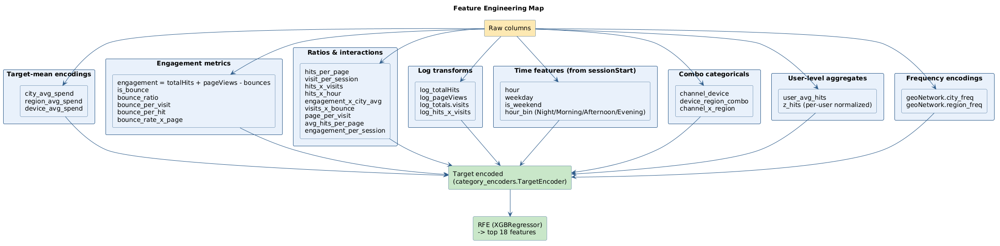
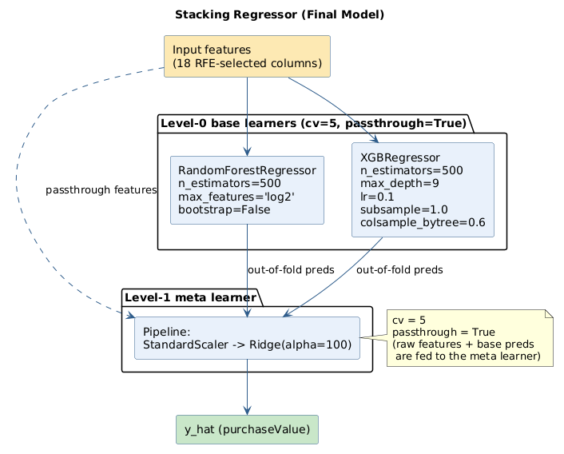
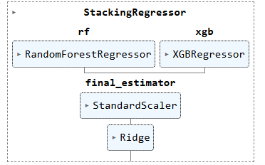

# Engage 2 Value — From Clicks to Conversions

Predicting per-session **`purchaseValue`** from web-analytics clickstream data for the
Kaggle competition
[`engage-2-value-from-clicks-to-conversions`](https://www.kaggle.com/competitions/engage-2-value-from-clicks-to-conversions).

The full solution lives in a single notebook:
[`23f1001603_notebook_t22025.ipynb`](23f1001603_notebook_t22025.ipynb).
The final model is a **Stacking Regressor** (RandomForest + XGBoost as level-0
learners, Ridge over `StandardScaler` as the level-1 meta learner) trained on
**18 RFE-selected** features that are produced by ~40 engineered columns and
target-encoded categoricals.

---


https://github.com/user-attachments/assets/a3722369-cf50-4b91-92c3-b4092abb9102


---

## Table of contents

1. [Problem statement](#problem-statement)
2. [Dataset](#dataset)
3. [Exploratory data analysis](#exploratory-data-analysis)
4. [Architecture](#architecture)
5. [End-to-end pipeline](#end-to-end-pipeline)
6. [Feature engineering](#feature-engineering)
7. [Model](#model)
8. [Project layout](#project-layout)
9. [How to run](#how-to-run)
10. [Regenerating the diagrams](#regenerating-the-diagrams)
11. [Results](#results)

---

## Problem statement

Given anonymised browsing-session records (device, geo, channel, hit/page
counts, bounces, session timestamp, etc.), predict the **`purchaseValue`** — the
monetary value the user generates in that session. The metric used for model
selection in the notebook is **R²** on a held-out 20 % validation split.

## Dataset

The data is pulled directly from Kaggle via `kagglehub`:

| File | Shape | Purpose |
| --- | --- | --- |
| `train_data.csv` | features + `purchaseValue` | training/validation |
| `test_data.csv`  | features only | leaderboard prediction |

Key raw columns referenced by the pipeline:

- **Engagement** — `totalHits`, `pageViews`, `totals.bounces`, `totals.visits`, `sessionNumber`
- **User/session** — `userId`, `sessionStart`, `userChannel`, `deviceType`
- **Geo** — `geoNetwork.city`, `geoNetwork.region`
- **Target** — `purchaseValue`

## Exploratory data analysis

The outputs below are the actual plots and tables produced by re-running the
EDA cells of [`23f1001603_notebook_t22025.ipynb`](23f1001603_notebook_t22025.ipynb)
against the competition data.

### Data overview

| Attribute | Value |
| --- | --- |
| Rows | **116,023** |
| Columns | **52** (1 bool, 5 float64, 9 int64, 37 object) |
| Memory | ~45 MB |
| Target | `purchaseValue` (float64, 100 % non-null) |
| Time range | `date` 2016-08-01 → 2018-04-30 (encoded as YYYYMMDD int) |
| Users / sessions | ~122 k distinct `userId`, ~116 k sessions |

**Heavily missing columns** (model still uses them after imputation):

| Column | Non-null % |
| --- | --- |
| `trafficSource.adContent` | 2.6 % |
| `trafficSource.adwordsClickInfo.slot` / `isVideoAd` / `adNetworkType` / `page` | 3.7 % |
| `trafficSource.keyword` | 38 % |
| `trafficSource.isTrueDirect` | 37 % |
| `trafficSource.referralPath` | 37 % |
| `totals.bounces` | 41 % |
| `new_visits` | 69 % |
| `pageViews` | 99.99 % (only 8 NaNs) |

**Constant / placeholder columns** (the data is the Google Analytics demo
export, so many device/browser/screen columns are sentinel strings or
single-valued — they carry no signal and are absorbed harmlessly by tree
models / target encoding):

- `device.screenResolution`, `device.mobileDeviceBranding`,
  `device.mobileInputSelector`, `device.mobileDeviceMarketingName`,
  `device.operatingSystemVersion`, `device.flashVersion`,
  `device.browserSize`, `device.browserVersion`, `device.screenColors`,
  `device.mobileDeviceModel`, `device.language`, `browserMajor`,
  `geoNetwork.networkLocation` → all `"not available in demo dataset"`
- `screenSize` → only `medium`; `socialEngagementType` → only `Not Socially Engaged`
- `totals.visits` → always 1; `totals.bounces` → always 1 when present; `locationZone` → always 8

### Target distribution

`purchaseValue` is **extremely right-skewed**. The describe table tells the
whole story:

| stat | purchaseValue |
| --- | --- |
| count | 116,023 |
| mean  | 2.66 × 10⁷ |
| std   | 2.05 × 10⁸ |
| min   | 0 |
| 25 %  | **0** |
| 50 %  | **0** |
| 75 %  | **0** |
| max   | 2.31 × 10¹⁰ |

The 75th percentile is still zero — i.e. **at least 75 % of sessions
generate no revenue**, and the mean is driven almost entirely by a thin tail
of very-high-value sessions. This is why the modelling stage uses tree-based
learners (RandomForest, XGBoost, HistGradientBoosting) — they handle skewed
targets and outliers gracefully — and why a regularised Ridge meta-learner
sits on top of a `StandardScaler`.



### Top numeric features

Quick histograms of the first six numeric columns. `userId` is essentially
uniform (each user contributes a comparable number of sessions),
`sessionNumber` is heavily right-tailed (median 1, max **447**),
`totals.visits` is effectively constant at 1, `pageViews` and `totalHits`
both have median 2 but reach 469 / 500 respectively, and `sessionId` spreads
across a clear time range. These shapes motivate the **log transforms** and
**per-user z-scoring** applied during feature engineering.



### Categorical landscape

A few highlights from `value_counts()` on the categorical columns:

| Feature | Cardinality | Dominant levels |
| --- | --- | --- |
| `browser` | 34 | Chrome 73 %, Safari 17 %, Firefox 3 % |
| `os` | 18 | Windows 34 %, Macintosh 32 %, Android 14 %, iOS 11 % |
| `deviceType` | 3 | desktop 75 %, mobile 22 %, tablet 3 % |
| `userChannel` | 8 | Organic 40 %, Referral 19 %, Social 18 %, Direct 16 %, Paid 3 % |
| `geoNetwork.continent` | 6 | Americas 60 %, Asia 19 %, Europe 17 % |
| `locationCountry` | 193 | United States 52 %, India 5 %, UK 3 % |
| `geoNetwork.region` | 388 | 52 % `not available in demo dataset`, then California 16 %, New York 5 % |
| `geoNetwork.city` | 695 | 52 % unavailable, then Mountain View / NYC / SF |
| `trafficSource` | 161 | google 38 %, (direct) 32 %, youtube.com 17 % |
| `trafficSource.medium` | 7 | organic 35 %, (none) 32 %, referral 27 %, cpc 4 % |
| `geoCluster` | 5 | Region_1…Region_5 are roughly evenly distributed (~20 % each) |
| `trafficSource.referralPath` | 941 | 63 % NaN, then `/`, `/yt/about/`, `/analytics/web/` |

The high-cardinality, long-tailed categoricals (`trafficSource`,
`geoNetwork.region`, `geoNetwork.city`, `trafficSource.referralPath`) are
exactly the ones that benefit most from **target encoding** rather than
one-hot — they would explode the feature space and overfit otherwise.

### Pairwise relationships with the target

Pairplot of the top three numerically-correlated features with the target.
The off-diagonal scatter plots highlight non-linear relationships (e.g.
high-`purchaseValue` sessions cluster at moderate `pageViews` /
`sessionNumber`, not at the extremes) — another reason a linear-only model
would underperform on this dataset.



## Architecture

The whole project is notebook-based and runs inside a Kaggle/Jupyter Python
environment. The runtime, the libraries it depends on, and the trained model
fit together like this:



## End-to-end pipeline

Login → data download → EDA → impute → engineer features → target-encode →
RFE → train/validate → stack → submit.



The pipeline runs three candidate models (ElasticNet, HistGradientBoosting,
Stacking) and selects the Stacking Regressor based on validation R². The
chosen model is then refit on the full training set before predicting
`test_data.csv` and writing `submission.csv`.

## Feature engineering

Around **40 derived features** are produced from the raw columns. They fall
into eight families, all of which are target-encoded (where categorical) and
then fed to RFE for selection of the final 18:



The families are:

| Family | Examples | Why |
| --- | --- | --- |
| Target-mean encodings | `city_avg_spend`, `region_avg_spend`, `device_avg_spend` | Inject historical purchase signal per cohort |
| Engagement metrics    | `engagement`, `is_bounce`, `bounce_ratio`, `bounce_per_visit`, `bounce_per_hit`, `bounce_rate_x_page` | Capture how active a session was |
| Ratios & interactions | `hits_per_page`, `visit_per_session`, `hits_x_visits`, `engagement_x_city_avg`, `page_per_visit`, `hits_x_hour` | Non-linear combinations of useful raw signals |
| Log transforms        | `log_totalHits`, `log_pageViews`, `log_totals.visits`, `log_hits_x_visits` | Tame heavy-tailed numerics |
| Time features         | `hour`, `weekday`, `is_weekend`, `hour_bin` (Night/Morning/Afternoon/Evening) | Daily/weekly seasonality |
| Combo categoricals    | `channel_device`, `device_region_combo`, `channel_x_region` | Cross-category effects |
| User-level aggregates | `user_avg_hits`, `z_hits` (per-user normalised) | Behaviour relative to the user's own baseline |
| Frequency encodings   | `geoNetwork.city_freq`, `geoNetwork.region_freq` | Popularity prior on geo |

All categorical features (raw and combo) are encoded with
`category_encoders.TargetEncoder`. Recursive Feature Elimination on top of an
`XGBRegressor` then narrows the table down to the **top 18** features that
actually go into the final model.

## Model

The final model is a `StackingRegressor` with `passthrough=True` and `cv=5`,
i.e. the meta learner sees both the out-of-fold predictions of the base
models **and** the raw 18 input features.



The sklearn `set_config(display='diagram')` render of the fitted estimator
in the notebook looks like this:



| Role | Estimator | Key hyper-parameters |
| --- | --- | --- |
| Base 0 | `RandomForestRegressor` | `n_estimators=500`, `max_features='log2'`, `bootstrap=False` |
| Base 1 | `XGBRegressor` | `n_estimators=500`, `max_depth=9`, `learning_rate=0.1`, `subsample=1.0`, `colsample_bytree=0.6` |
| Meta   | `Pipeline(StandardScaler → Ridge(alpha=100))` | strongly regularised, scaler is required because Ridge is scale-sensitive |

For comparison, the notebook also tunes:

- **ElasticNet** — `StandardScaler → ElasticNet`, `RandomizedSearchCV` over
  `alpha` (50 log-spaced values) and `l1_ratio` (20 values), 3-fold CV.
- **HistGradientBoostingRegressor** — `RandomizedSearchCV` over
  `max_iter`, `max_depth`, `learning_rate`, `max_leaf_nodes`.

The Stacking model wins on the validation R² and is refit on the full
`(X, y)` before predicting on `X_test`.

## Project layout

```
EngagetoValue-main/
├── 23f1001603_notebook_t22025.ipynb   # main notebook (entire pipeline)
├── README.md
└── docs/
    ├── render_diagrams.py             # renders every .puml to a PNG via plantuml.com
    ├── diagrams/                      # PlantUML sources
    │   ├── architecture.puml
    │   ├── pipeline.puml
    │   ├── feature_engineering.puml
    │   └── model_stack.puml
    └── images/                        # rendered PNGs referenced by this README
        ├── architecture.png            # PlantUML render
        ├── pipeline.png                # PlantUML render
        ├── feature_engineering.png     # PlantUML render
        ├── model_stack.png             # PlantUML render
        ├── Target_Dist.png             # EDA: purchaseValue histogram
        ├── Top_Feat.png                # EDA: top numeric feature histograms
        ├── Pairplot.png                # EDA: pairwise relationships with target
        └── Model.png                   # sklearn StackingRegressor diagram
```

## How to run

### Option A — Kaggle (recommended, mirrors how it was built)

1. Open the competition page:
   [`engage-2-value-from-clicks-to-conversions`](https://www.kaggle.com/competitions/engage-2-value-from-clicks-to-conversions).
2. Click **New Notebook** and upload `23f1001603_notebook_t22025.ipynb`.
3. Attach the competition dataset to the notebook.
4. **Run All**. `submission.csv` will appear in `/kaggle/working/`.

### Option B — Local Jupyter

```bash
# Python 3.10+ recommended
pip install -U pip
pip install pandas numpy matplotlib seaborn scikit-learn xgboost \
            category_encoders kagglehub jupyter
```

You also need a Kaggle API token (`~/.kaggle/kaggle.json` or env vars
`KAGGLE_USERNAME` / `KAGGLE_KEY`) and you must have **accepted the competition
rules** on the Kaggle site once. Then:

```bash
jupyter notebook 23f1001603_notebook_t22025.ipynb
```

The first cell calls `kagglehub.login()`; the second downloads the dataset.
If you'd rather work fully offline, manually place `train_data.csv` and
`test_data.csv` somewhere on disk and replace the `read_csv` paths.

## Regenerating the diagrams

The PNGs under `docs/images/` are generated from the `.puml` sources under
`docs/diagrams/` using the public PlantUML server — no local `plantuml.jar`
or Java install is required.

```bash
pip install requests
python docs/render_diagrams.py
```

The script POSTs each `.puml` file to `https://www.plantuml.com/plantuml/png/`
and writes the resulting PNG next to its source. Edit a `.puml`, re-run the
script, and the README will pick up the new image automatically.

## Results

- **Selected model:** Stacking Regressor (RandomForest + XGBoost → Ridge).
- **Validation split:** 80 / 20, `random_state=42`.
- **Scoring metric:** R² on the validation split (driven by `sklearn.metrics.r2_score`).
- **Submission file:** `submission.csv` with columns `id, purchaseValue`.

The exact validation R² depends on the data snapshot at the time the notebook
is run — re-execute the notebook end-to-end to reproduce the numbers and
print the live scores for ElasticNet, HistGradientBoosting and the Stacking
model side by side.
